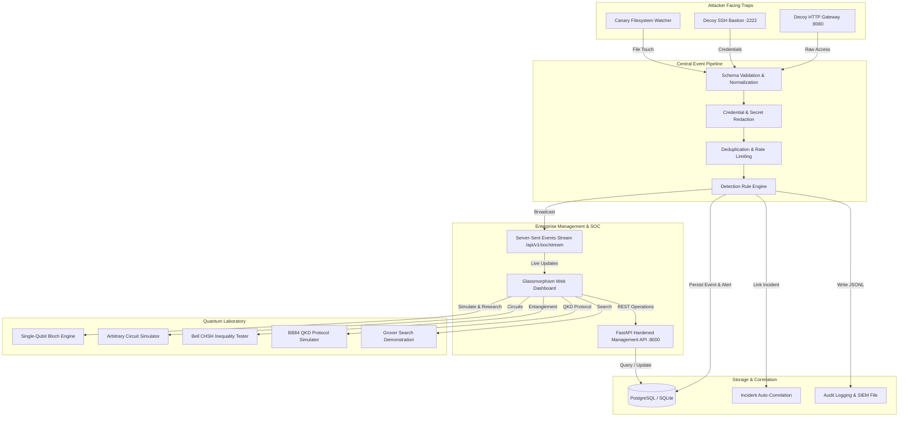

# QuantumGuard Enterprise Architecture Specification

## 1. System Components & Flow

---

## 2. Trust Boundaries & Separation of Concerns

1. **Management Interface vs Attacker Honeypot Separation**:
   - Management API and Dashboard run on Port `8000`, protected by PBKDF2 password hashing, JWT bearer tokens, and server-side RBAC.
   - Attacker-facing HTTP decoy runs on Port `8080` and SSH decoy on Port `2222`.
   - Attacker traps have zero read access to management APIs, users, or active incidents.
2. **Deterministic Credential Redaction**:
   - Passwords and auth cookies received by decoy traps are automatically sanitized via recursive pattern matching prior to being persisted or broadcast to the SSE stream.
3. **Scientific Realism Separation**:
   - Deception events represent real-world observed accesses to decoy files or honeypot ports.
   - The Quantum Laboratory is a modular research and simulation engine running density-matrix and statevector mathematics. Quantum simulation does not physically protect classical data.
