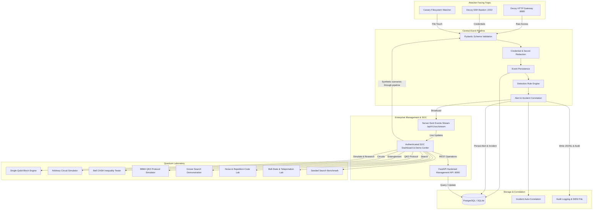

# QuantumGuard Enterprise Architecture Specification

## 1. System Components & Flow

---

## 2. Trust Boundaries & Separation of Concerns

1. **Management Interface vs Attacker Honeypot Separation**:
   - Management API and Dashboard run on Port `8000`; SOC telemetry requires authenticated viewer access, while writes require analyst/admin roles. New administrator bootstrap credentials are configured by environment.
   - Attacker-facing HTTP decoy runs on Port `8080` and SSH decoy on Port `2222`.
   - Attacker traps have zero read access to management APIs, users, or active incidents.
2. **Deterministic Credential Redaction**:
   - Passwords and auth cookies received by decoy traps are automatically sanitized via recursive pattern matching prior to being persisted or broadcast to the SSE stream.
3. **Scientific Realism Separation**:
   - Deception events may be genuine trap telemetry or explicitly labeled synthetic demo data. Synthetic demos use the same event pipeline and have per-run cleanup.
   - The Quantum Laboratory is a modular research simulator running density-matrix and statevector mathematics. Quantum simulation does not physically protect classical data or generate SOC detections.
