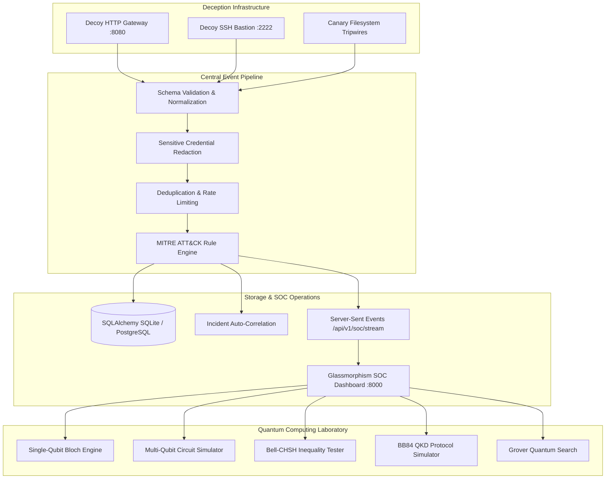

# QuantumGuard — Enterprise Deception & Quantum Laboratory Platform v2.4

[](https://www.python.org/)
[](https://fastapi.tiangolo.com)
[](LICENSE)
[](https://attack.mitre.org/)
[](quantum_honeypot/tests/)

QuantumGuard is a full-stack cybersecurity deception technology platform integrated with a real-time Security Operations Center (SOC) dashboard and an interactive quantum information research laboratory.

---

## 1. System Architecture

QuantumGuard is engineered into two strictly separated, complementary layers:



### Layer A: Production Cybersecurity Deception & Detection
- **Decoy Assets**: Emulated Stripe API credentials, PostgreSQL database strings, AWS IAM metadata endpoints, OpenSSH bastion prompts, and canary filesystem files.
- **Central Event Pipeline**: Schema validation (Pydantic), deterministic secret/password redaction, deduplication, and explainable MITRE ATT&CK detection rules.
- **Incident Management**: Persistent database records (`OPEN`, `INVESTIGATING`, `RESOLVED`, `CLOSED`), automated incident correlation, and analyst notes audit trail.
- **Real-Time SOC Streaming**: Server-Sent Events (SSE) broadcasting live alerts to connected analysts without polling.
- **Enterprise Access Control**: NIST-compliant PBKDF2 password hashing (`600,000` iterations) and signed JWT tokens with Role-Based Access Control (`Admin`, `Analyst`, `Viewer`).

### Layer B: Quantum Computing Research Laboratory
- **Statevector & Bloch Sphere**: Exact single-qubit density matrix representations, gate operations ($H, X, Y, Z, S, T$), and 3D Bloch vector calculations.
- **Arbitrary Circuit Simulator**: Multi-qubit circuit simulation (1 to 8 qubits) with CNOT entangling gates and shot-sampling probability distributions.
- **Bell-CHSH Inequality Testing**: Optimal measurement configurations demonstrating quantum non-locality ($S = 2\sqrt{2} \approx 2.8284 > 2.0$).
- **No-Cloning Demonstration**: Numerical comparison against the universal Bužek-Hillery bound ($F \le 5/6 \approx 0.8333$).
- **BB84 QKD Simulation**: Complete key distribution lifecycle with Alice preparation, Eve intercept-resend attack, Bob measurement, sifting, and Quantum Bit Error Rate (QBER) analysis.
- **Grover Search**: Amplitude amplification database search showing quadratic quantum speedup.

> [!NOTE]
> **Scientific Integrity Disclosure**: Classical deception assets (canary files, API keys, honeypot ports) detect real-world unauthorized access to decoy assets. The Quantum Laboratory models fundamental quantum-information principles. Simulating quantum states in software does not physically alter or protect classical files or passwords.

---

## 2. Quickstart & Local Setup

### Prerequisites
- Python 3.11+
- Node.js (optional, for frontend static development)
- Docker & Docker Compose (optional, for containerized deployment)

### 1. Installation
```powershell
# Clone repository
git clone https://github.com/your-org/Quantum-honeypot.git
cd Quantum-honeypot

# Create and activate virtual environment
python -m venv venv
.\venv\Scripts\Activate.ps1

# Install dependencies
pip install -r requirements.txt
```

### 2. Run Automated Test Suite
```powershell
python -m pytest -v
```
*Output: 14 passed (covers quantum mathematics, authentication, event pipeline, and REST API).*

### 3. Start the Unified Web Platform
```powershell
uvicorn quantum_honeypot.api.app:app --host 127.0.0.1 --port 8000 --reload
```
Open your browser at **`http://localhost:8000/`**.

**Default Developer Credentials**:
- **Username**: `admin`
- **Password**: `QuantumGuard@Admin2026`

---

## 3. CLI Management Commands

QuantumGuard preserves full backward compatibility with CLI operations:

```powershell
# View operational honeypot status
python main.py status

# Deploy filesystem canary tripwire files
python main.py deploy

# Verify honeytoken with simulated intercept strategy
python main.py verify --strategy random

# Run multi-trial Monte-Carlo benchmark & generate scientific PDF report
python main.py simulate --trials 50 --qubits 8 --pdf
```

---

## 4. Docker Compose Deployment

Run the complete production stack (PostgreSQL database + QuantumGuard application + persistent volumes):

```bash
docker-compose up -d --build
```

Check health:
```bash
curl http://localhost:8000/healthz
curl http://localhost:8000/readyz
```

---

## 5. API Reference

| Endpoint | Method | Role | Description |
|---|---|---|---|
| `/healthz` | GET | Public | Liveness probe |
| `/readyz` | GET | Public | Readiness probe with database health check |
| `/api/v1/auth/login` | POST | Public | Authenticate user & return Bearer token |
| `/api/v1/auth/me` | GET | Authenticated | Retrieve current user profile and role |
| `/api/v1/soc/overview` | GET | Public | Operational metrics, event counts, severity breakdown |
| `/api/v1/soc/events` | GET | Public | Filtered, paginated security event log |
| `/api/v1/soc/stream` | GET | Public | Server-Sent Events (SSE) real-time event stream |
| `/api/v1/soc/incidents` | GET | Public | Active and resolved incidents with analyst notes |
| `/api/v1/soc/incidents/{id}/status` | PATCH | Analyst | Update incident status (`OPEN`, `INVESTIGATING`, `RESOLVED`) |
| `/api/v1/soc/decoys` | GET | Public | List registered deception assets |
| `/api/v1/soc/decoys/simulate-breach` | POST | Analyst | Trigger authorized test breach drill |
| `/api/v1/soc/reports/export` | GET | Viewer | Export sanitized event logs (CSV or JSON) |
| `/api/v1/quantum/bloch` | POST | Public | Single-qubit statevector and Bloch sphere coordinates |
| `/api/v1/quantum/circuit` | POST | Public | Multi-qubit circuit simulation and measurement shots |
| `/api/v1/quantum/bell-chsh` | POST | Public | Bell CHSH inequality test |
| `/api/v1/quantum/bb84` | POST | Public | BB84 QKD simulation with Eve interception toggle |
| `/api/v1/quantum/grover` | POST | Public | Grover search algorithm demonstration |
| `/api/v1/quantum/no-cloning` | GET | Public | Universal quantum cloning machine (UQCM) bound |

Full interactive Swagger/OpenAPI documentation is available at **`http://localhost:8000/docs`**.

---

## 6. Repository Structure

```
Quantum-honeypot/
├── Dockerfile                       ← Production Docker container specification
├── docker-compose.yml               ← Multi-service stack (App + PostgreSQL)
├── requirements.txt                 ← Pinned Python dependencies
├── pytest.ini                       ← Automated test configuration
├── .env.example                     ← Safe environment variables template
├── index.html                       ← Glassmorphism Web SOC Dashboard & Quantum Lab
├── styles.css                       ← Cyberpunk styling and UI tokens
├── js/                              ← Frontend modules
│   ├── api.js                       ← Centralized API & SSE client
│   ├── app.js                       ← Dashboard, incidents, and quantum visualization
│   ├── quantum_engine.js            ← Educational quantum simulator
│   └── state.js                     ← UI state store
├── quantum_honeypot/                ← Backend Python package
│   ├── api/                         ← FastAPI management application & routers
│   │   ├── app.py                   ← FastAPI app, static mounting, CORS
│   │   ├── auth_router.py           ← Authentication & session endpoints
│   │   ├── soc_router.py            ← SOC telemetry, events, incidents, SSE
│   │   └── quantum_router.py        ← Quantum Lab simulation endpoints
│   ├── core/                        ← Quantum physics & mathematics engines
│   │   ├── quantum_lab.py           ← Bloch, circuits, Bell-CHSH, BB84, Grover
│   │   ├── states.py                ← Density matrices & quantum states
│   │   ├── gates.py                 ← Unitary quantum gates
│   │   ├── channels.py              ← Noise & decoherence models
│   │   ├── fidelity.py              ← Uhlmann fidelity calculations
│   │   └── cloning.py               ← Bužek-Hillery UQCM bound
│   ├── db/                          ← Persistent database layer
│   │   ├── database.py              ← Engine, SessionLocal, init_db seed
│   │   └── models.py                ← SQLAlchemy models (Events, Incidents, Users)
│   ├── detection/                   ← Security event ingestion & rules engine
│   │   ├── pipeline.py              ← Pipeline, redaction, rules, incident correlation
│   │   ├── alerts.py                ← Alert dispatcher bridge
│   │   ├── detector.py              ← Bayesian threshold detector
│   │   └── siem_logger.py           ← ECS / JSONL structured event logger
│   ├── security/                    ← Cryptographic security & RBAC
│   │   └── auth.py                  ← PBKDF2 hashing, JWT tokens, RBAC dependencies
│   ├── traps/                       ← Deception trap daemons
│   │   ├── http_trap.py             ← Decoy HTTP Gateway (Port 8080)
│   │   ├── ssh_trap.py              ← Decoy SSH Bastion (Port 2222)
│   │   └── canary_trap.py           ← Filesystem canary deployer & watcher
│   ├── tokens/                      ← Honeytoken register & generator
│   ├── reporting/                   ← Analytics, charts, and PDF generation
│   ├── tests/                       ← Comprehensive test suite (14 tests)
│   └── cli.py                       ← Unified CLI management commands
├── docs/                            ← Technical specifications & PDF reports
├── DEPLOYMENT.md                    ← Production deployment instructions
├── ARCHITECTURE.md                  ← System architecture & trust boundaries
├── SECURITY.md                      ← Threat model & containment rules
└── QUANTUM_CONCEPTS.md              ← Quantum information mathematical reference
```
